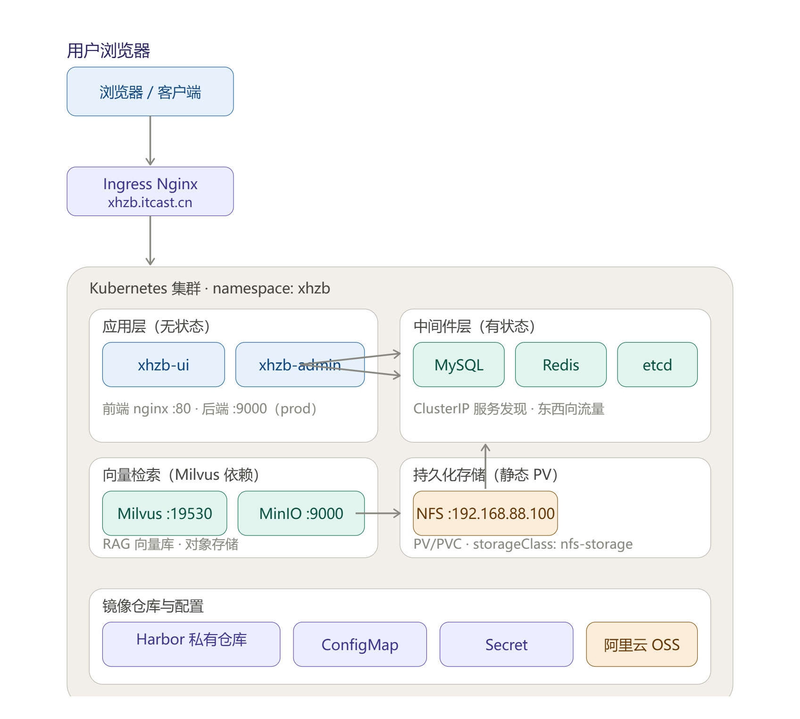

# 智慧养老平台部署与 Kubernetes 迁移

一套基于 **RuoYi-Vue** 框架的智慧养老后台管理系统（前后端分离 + AI + RAG 架构）的完整部署实践：先以 Docker Compose 完成单机部署，再针对单点故障、无自愈、无弹性伸缩等问题，将平台整体迁移至 Kubernetes 集群，沉淀完整的部署手册与排障记录。



## 项目背景

项目最初使用 Docker Compose 一键拉起全部容器，但存在明显局限：

- 只能单机运行，有单点故障风险
- 容器挂掉不会自愈，没有滚动发布与弹性伸缩
- 配置与密码散落在文件中，难以统一管理
- 服务发现局限于 Compose 网络内，无法满足集群级需求

迁移到 Kubernetes 后，应用以「Deployment + Service + PVC + ConfigMap/Secret + Ingress」的方式声明式管理，实现自愈、滚动更新/回滚、配置集中管理与统一入口。

## 技术栈

| 分类 | 组件 |
|------|------|
| 容器与编排 | Docker、Docker Compose、Kubernetes（kubeadm）、Containerd、Calico |
| 镜像仓库 | Harbor（HTTPS + 自建 CA 证书） |
| 应用 | Spring Boot（xhzb-admin :9000）、Vue 前端（nginx 托管 :80） |
| 中间件 | MySQL 8.0、Redis 7.2、etcd、MinIO、Milvus v2.4.17 |
| 存储与高可用 | NFS + 静态 PV/PVC、阿里云 OSS、Nginx + Keepalived（VRRP VIP 漂移） |
| 自动化 | Ansible（Playbook 批量初始化）、Shell 一键部署脚本 |
| AI | RAG（文档切分/向量化/检索召回）、Dify 知识库问答 |

## 集群规划

| 主机名 | IP | 角色 |
|--------|------|------|
| repo | 192.168.88.100 | 本地 Yum 源、NFS 存储服务端、Ansible 控制节点 |
| harbor | 192.168.88.101 | Harbor 私有镜像仓库（HTTPS :443） |
| master01 | 192.168.88.102 | K8s 控制平面 |
| node01 / node02 | 192.168.88.103 / 104 | K8s 工作节点 |

## 仓库内容

```
smart-elderly-k8s/
├── README.md                          ← 本文件
├── K8s部署架构图.png                   ← 集群架构图
├── check-nginx.sh                     ← Keepalived 健康检测脚本（Nginx 宕机触发 VIP 漂移）
├── 一.本地Yum源仓库服务器与harbor仓库服务器的搭建.md
├── 二.k8s集群部署.md
├── 三.项目的k8s部署.md                ← Compose → K8s 迁移全过程
├── 四.k8s-mysql-排障记录.md           ← 典型故障链式排查记录
└── 项目dockercompose集成部署/          ← Docker Compose 单机部署方案
```

## 核心亮点

- **本地软件源 + 离线可部署**：基于 Nginx + createrepo 搭建本地 Yum 源，Harbor 自建 CA 签发 HTTPS 证书，所有应用与基础镜像统一推送 Harbor，实现内网可拉取、版本可控
- **Ansible 自动化初始化**：Playbook 批量完成节点基础配置与集群加入，替代逐台手工操作
- **镜像构建优化**：后端 Maven 容器打包 + 多阶段构建；前端 npm 多阶段构建（node 构建 → nginx 产物），并修复 npm audit 卡死、Linux 大小写敏感等构建问题
- **配置与镜像解耦**：ConfigMap 挂载数据库初始化脚本（xhzb.sql，44 张表）、Secret 管理 MySQL/Redis 密码与 OSS/OpenAI 密钥，替代 YAML 明文与 Dockerfile 硬编码
- **有状态组件持久化**：NFS 静态 PV/PVC 为 MySQL、Redis、etcd、MinIO、Milvus 提供持久化，容器重建数据不丢失
- **健康检测自愈**：check-nginx.sh 检测 Nginx 容器存活，宕机自动停止 Keepalived 触发 VIP 漂移

## 迁移思路（Compose → K8s）

一个 Compose 服务对应到 K8s 的一组资源：

```
容器服务        →  Deployment（怎么跑：镜像、副本、探针）
environment    →  ConfigMap / Secret（配置与密码外置）
volume 数据卷  →  PV / PVC（数据放哪）
端口映射        →  Service + Ingress（服务发现 + 统一入口）
```

部署顺序遵循「**先中间件、后应用**」——应用启动即强依赖中间件（实测 Milvus 未就绪时后端 10 秒超时崩溃），K8s 没有 depends_on，只能靠部署顺序 + 探针保证。

## 踩坑与排障（详见《四.k8s-mysql-排障记录.md》）

一次 MySQL 部署遇到**链式因果**的三连坑，逐层定位解决：

| # | 现象 | 根因 | 解决 |
|---|------|------|------|
| 1 | Pod Pending：`unbound PersistentVolumeClaims` | 集群无 `nfs-storage` 供给者 | 创建静态 PV（Retain 策略） |
| 2 | PVC 一直 Pending | 无 StorageClass / provisioner | 静态供给快速验证，动态 provisioner 为长期方案 |
| 3 | ContainerCreating：`mount.nfs: access denied` | NFS 目录未建 + 未登记 `/etc/exports` | 建目录、chmod、`exportfs -arv` 重新发布 |

其他典型问题：etcd 镜像无 ENTRYPOINT（YAML 须 `command` + `args` 配合）、npm 10 audit 请求挂起（`--no-audit --no-fund`）、Windows 大小写不敏感导致 Linux 构建报错（sed 批量修正 import 路径）、ingress-nginx NodePort 访问需带端口等。

**排障方法论**：第一现场看 `kubectl describe pod` 的 Events —— 带 `PersistentVolumeClaim` 查存储、带 `Insufficient cpu` 查节点资源、带 `FailedMount` 查 NFS 导出、带 `cni` 查网络插件。

## 部署验证

```bash
kubectl -n xhzb get pods          # 全部 1/1 Running
kubectl -n xhzb get svc           # ClusterIP 服务发现
kubectl logs -n xhzb deploy/xhzb-admin --tail=50
# 浏览器访问（本地配置 hosts 映射）：
# http://xhzb.itcast.cn:32299
```

## 面向生产化的改进方向

- MySQL 跑 NFS 的 IO 延迟高，生产建议 local PV / 块存储
- 补充 `resources.requests/limits` 与 livenessProbe（当前为 BestEffort）
- 私有 Harbor 需配置 `imagePullSecrets`
- 基于 metrics-server 接入 HPA 自动扩缩容（CPU 70%，2~10 副本）
